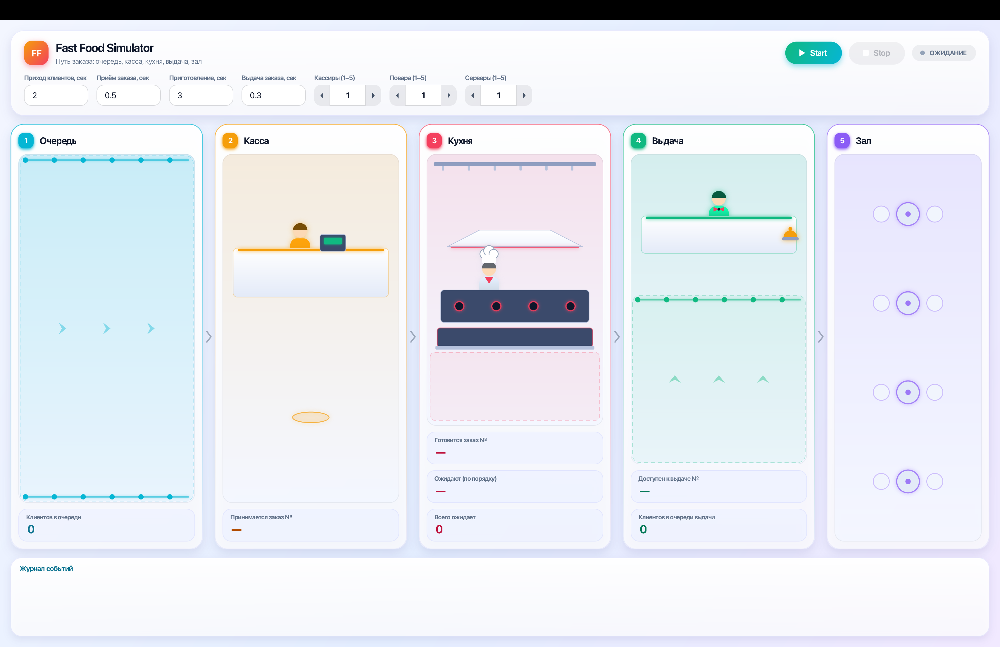
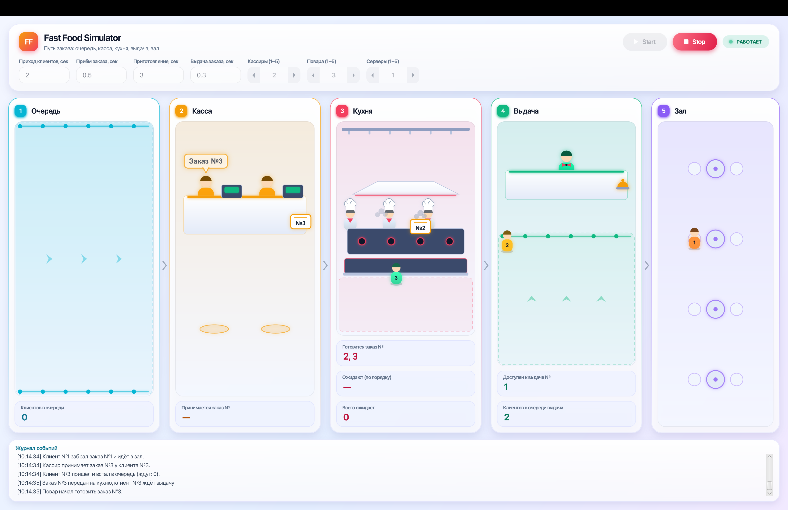

# Fast Food Simulator

Лабораторная работа №1: графическое приложение на Java 17 + JavaFX, которое симулирует
ресторан быстрого питания. Клиенты приходят в очередь, Order Taker принимает заказ и создаёт
тикет, Cook готовит, Server объявляет номер, клиент забирает заказ и идёт в зал.

Каждый актёр работает в своём потоке, тикет заказа представлен двумя `CompletableFuture`
(Promise): один ждёт Server, другой ждёт Customer. Симуляционные библиотеки не используются.

## Скриншоты

| Главное окно | Симуляция идёт |
|---|---|
|  |  |

(Файлы `main.png`, `running.png`, `warning.png` нужно положить в `docs/screenshots/`.)

## Требования

- JDK 17 или новее
- Maven 3.8+
- VS Code с Extension Pack for Java (или любая другая IDE)

JavaFX скачивается Maven'ом как зависимость, отдельно ставить не нужно.

## Запуск

```
mvn clean test       # тесты
mvn javafx:run       # запуск приложения
```

## Как пользоваться

1. Введите времена в секундах (дробные числа можно писать с точкой или запятой, `1.5` или `1,5`):
   - приход клиентов и приготовление заказа: от 0.5 до 60;
   - приём заказа кассиром и выдача заказа сервером: от 0.1 до 60.
   Задайте число кассиров, поваров и серверов (от 1 до 5).
2. Нажмите **Start** (кнопки Start / Stop и статус стоят в шапке). Поля ввода блокируются.
3. Следите за зонами: Очередь, Касса, Кухня, Выдача, Зал. В каждой зоне есть текстовые поля
   с номерами и счётчиками, а клиенты и тикеты двигаются по сцене. В зоне «Выдача» поле
   «Доступен к выдаче» показывает последние объявленные номера (столько, сколько серверов).
   Внизу окна журнал событий со временем каждого шага.
4. Нажмите **Stop**, чтобы остановить симуляцию в любой момент. После этого можно запустить её снова
   (всё начнётся с нуля, нумерация с 1).

Если значение введено неверно (пусто, буквы, `2d`, `1e1`, `+2`, `.5`, меньше 0.5, больше 60),
под полями появится понятное предупреждение, симуляция не запустится.

## Структура проекта

```
src/main/java/fastfood/
├── Main.java        запуск JavaFX, подключение слоя визуала
├── model/           IdGenerator, Customer, Ticket (два Promise), SimulationConfig
├── queue/           CustomerQueue, TicketQueue (потокобезопасные FIFO на LinkedBlockingQueue)
├── validation/      IntervalValidator, ValidationResult (проверка ввода)
├── events/          SimulationListener (Observer: события симуляции)
├── actors/          CustomerGenerator, OrderTaker, Cook, Server, CustomerWaiter
├── engine/          Simulation (потоки, старт/стоп), StateTracker, SimulationSnapshot
└── ui/              MainView, MainController, панели зон, AnimationManager, Scenery
src/main/resources/style.css
src/test/java/fastfood/   тесты (модель, очереди, актёры, движок, валидация)
docs/                     ARCHITECTURE.md, DEFENSE.md, REVIEW.md
```

## Допущения проекта

- ТЗ не задаёт скорость Order Taker и Server, поэтому пользователь вводит её сам. Если время не задано
  (короткие конструкторы `SimulationConfig`), берутся значения по умолчанию:
  приём заказа `ORDER_TAKE_MS = 500` мс, выдача `SERVE_MS = 300` мс.
- Кассиров, поваров и серверов может быть несколько (до 5 каждого). Каждый работает в своём потоке
  и берёт работу из общей FIFO-очереди. При нескольких серверах порядок объявления номеров
  может чуть расходиться с порядком готовности.
- Server ждёт `cookPromise` через `get()`. К моменту выдачи Promise уже завершён (Cook завершает его
  до добавления тикета в очередь выдачи), поэтому ожидание на практике мгновенное.
- Клиенты приходят и заказы готовятся через фиксированные интервалы (`Thread.sleep` в цикле актёра).
  Реальный период чуть больше заданного на время самой работы цикла.

## Принципы SOLID (честная оценка)

- **S (единственная ответственность):** выполнено в основном. Актёры только выполняют свою роль,
  `Simulation` управляет потоками, `StateTracker` хранит номера в работе, `IntervalValidator` проверяет ввод,
  UI рисует. Частично: `AnimationManager` большой (около 580 строк) и совмещает раскладку и обработку событий.
- **O (открытость/закрытость):** частично. Новый слой визуала подключается через `VisualLayer`
  без правок движка, но новую роль в симуляцию добавить можно только правкой `Simulation`.
- **L (подстановка Лисков):** выполнено тривиально: наследования почти нет, `VisualLayer` и
  `MainController` подставляются везде, где нужен `SimulationListener`.
- **I (разделение интерфейсов):** частично. В `SimulationListener` 8 методов, и каждый потребитель
  получает их все, хотя `StateTracker` и UI реагируют не на все одинаково.
- **D (инверсия зависимостей):** частично. Актёры и UI зависят от интерфейса `SimulationListener`,
  а не друг от друга. Но `Simulation` сам создаёт конкретные актёры и очереди через `new`,
  а `MainController` создаёт `Simulation` и `IntervalValidator`.
