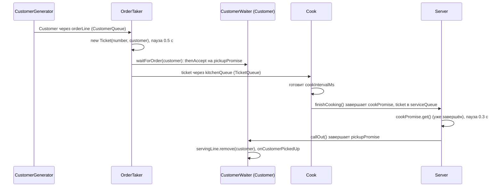
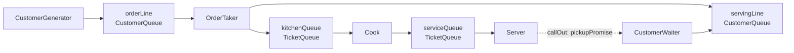

# Архитектура

## Эскиз окна

```
+--------------------------------------------------------------------------------------+
| Интервал прихода клиентов, сек [ 2 ]   Интервал приготовления заказа, сек [ 3 ]       |
| [Start] [Stop]                                                                        |
| (место для предупреждения о неверном вводе)                                           |
+------------+------------+----------------+-----------------+-------------------------+
|  Очередь   |   Касса    |     Кухня      |     Выдача      |          Зал            |
|            |            |                |                 |                         |
| клиенты    | Order Taker| карусель       | Server, стойка, | столики и стулья,       |
| ждут       | клиент и   | тикетов, Cook  | клиенты в       | клиенты едят            |
| заказа     | тикет      | у плиты, окно  | очереди выдачи  |                         |
|            |            | готовых заказов|                 |                         |
|            |            |                |                 |                         |
| [Клиентов  | [Принимает-| [Готовится     | [Заказ готов    | (текстовых полей нет)   |
|  в очереди]|  ся заказ №]| заказ №]       |  к выдаче №]    |                         |
|            |            | [Ожидают (по   | [Клиентов в     |                         |
|            |            |  порядку)]     |  очереди выдачи]|                         |
|            |            | [Всего ожидает]|                 |                         |
+------------+------------+----------------+-----------------+-------------------------+
  Поверх всех зон лежит прозрачный слой анимации (Pane), по нему двигаются клиенты и тикеты.
```

Роли и шаги ТЗ: 1-3 на кассе (Order Taker создаёт тикет, клиент уходит в очередь выдачи, тикет на карусель),
4-6 на кухне (Cook берёт тикет, готовит, передаёт Server), 7-9 на выдаче (Server объявляет номер,
клиент забирает заказ и идёт в зал).

## Взаимодействие актёров



## Очереди



`servingLine` нужна для отображения (счётчик и список клиентов в очереди выдачи), `CustomerWaiter`
убирает клиента из неё, когда его заказ объявлен.

## Потоки

| Поток | Что делает |
|---|---|
| `fastfood-generator` | `CustomerGenerator`: клиент в `orderLine`, пауза `customerIntervalMs` |
| `fastfood-order-taker` | `OrderTaker`: берёт клиента, пауза 0.5 с, кладёт тикет на кухню |
| `fastfood-cook` | `Cook`: берёт тикет, пауза `cookIntervalMs`, передаёт в `serviceQueue` |
| `fastfood-server` | `Server`: берёт готовый тикет, пауза 0.3 с, объявляет номер |
| JavaFX Application Thread | всё, что связано с интерфейсом и анимацией |

Все потоки актёров демоны (`setDaemon(true)`), создаёт их только `Simulation`.
Продолжение Promise у клиента (`CustomerWaiter`) выполняется в потоке Server, внутри `callOut()`.

**Остановка.** `Simulation.stop()`: ставит `running = false`, вызывает `interrupt()` у всех потоков,
ждёт каждый через `join(500)`, отменяет Promise оставшихся в очередях тикетов (`Ticket.cancel()`),
очищает очереди, обнуляет `StateTracker` и только потом вызывает `onSimulationStopped()`.
Актёры выходят из цикла по `InterruptedException` (флаг прерывания восстанавливается), `Server` ещё
и по `CancellationException`.

**`Platform.runLater`.** Актёры шлют события из своих потоков. `MainController.handleEvent` оборачивает каждое
событие в `Platform.runLater`; внутри проверяет `simulation.isRunning()` (поздние события после Stop
игнорируются), обновляет текстовые поля из `getSnapshot()` и передаёт событие в `VisualLayer`
(`AnimationManager`). Актёры про JavaFX ничего не знают.

**Порядок событий.** События рассылаются после изменения очередей, поэтому события из разных потоков
могут прийти в UI в другом порядке (например, `onOrderTakingStarted` раньше `onCustomerArrived`).
`AnimationManager` это учитывает (см. `REVIEW.md`, находки 2 и 3).

## Два вида Promise

Оба лежат в `model/Ticket` (`CompletableFuture<Ticket>`):

| Promise | Кто завершает | Кто ждёт |
|---|---|---|
| `cookPromise` (`getCookPromise()`) | `Cook` через `ticket.finishCooking()` | `Server`: `ticket.getCookPromise().get()` |
| `pickupPromise` (`getPickupPromise()`) | `Server` через `ticket.callOut()` | `CustomerWaiter.waitForOrder`: `thenAccept(...)` |

Связь: Cook завершает `cookPromise` и кладёт тикет в `serviceQueue`; Server берёт тикет, дожидается
`cookPromise`, объявляет номер (`onOrderCalled`) и завершает `pickupPromise`; продолжение клиента убирает его
из `servingLine` и шлёт `onCustomerPickedUp`. `OrderTaker` вызывает `customerWaiter.waitForOrder(...)`
раньше `kitchenQueue.add(...)`, чтобы клиент начал ждать до того, как тикет попадёт на кухню.
`Ticket.cancel()` отменяет оба Promise при Stop.

## Слои

```
ui (MainView, MainController, AnimationManager)
        |  Simulation, SimulationSnapshot, SimulationListener
engine (Simulation, StateTracker, SimulationSnapshot)
        |
actors (CustomerGenerator, OrderTaker, Cook, Server, CustomerWaiter)
        |
queue, model, validation, events
```

UI не знает про потоки актёров, актёры не знают про JavaFX. Связь идёт через `SimulationListener`.
`StateTracker` стоит между актёрами и UI: запоминает номера заказов в работе (принимается, готовится,
последний объявленный) и пересылает все события дальше, не давая исключению из UI убить поток актёра.
